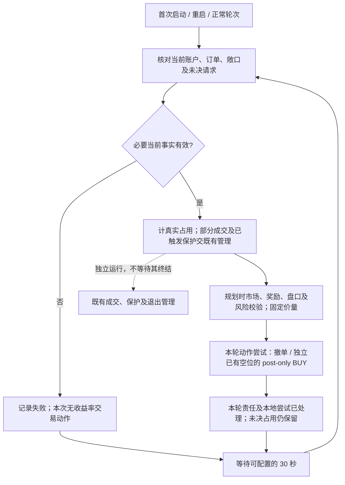

# LP 按当前事实逐轮选优，动作尝试与最终核清分离

2026-10-12，#336 的完整业务模型已由用户确认，设计状态为 accepted。代码实施仍需单独计划批准；尚未实现或部署，代码、运行配置及生产设置未变更。

## 共同循环

首次启动、重启和正常轮次使用同一入口：核对当前账户、订单、敞口及仍未决请求，按当前 BUY 挂单与候选收益比较形成本轮固定计划。没有上一计划不是失败，历史计划不决定下一步发送，不恢复旧未发送动作；这不要求删除历史计划或审计，也不禁止必要的持久请求资料。

本轮所有本地尝试处理结束后，等待可配置的 30 秒，才开始下一轮结果核对、当前事实读取及规划，轮次不重叠。必要当前账户／订单观测读取失败时，也记录并结束该次规划尝试，不发新单或收益率替换撤单，等待同一周期后重新观察；不推定空账户，不保存旧计划等待续发。独立保护及退出继续运行。

30 秒替代访谈中提出的 10 秒，并修订旧设计的 60 秒轮次间隔；这是设计值，运行配置未更改。它不是整轮执行超时，也不是单笔请求超时。本自动收益循环使用上述共同周期，不沿用旧固定计划恢复等待；与此循环无关的手动、保护及退出重试保持原规则。

## 当前占用与独立管理

有效当前事实及既有规划时预算、余额、allowance、目标名额规则仍是基础；计入真实挂单、库存成本和独立未决 BUY 预留，不引入已批准执行阶段的第二次财务审批。仅历史／报告传输失败时，既有当前事实回退来源仍可使用；若历史证据对特定未知归属或预留必不可少，保留其未知边界。必要当前事实缺失与单笔 E 未决不能混同。

已发送或无法排除已发送的 BUY 结果未核清时，保留原请求身份、归属、不可改写的审计、防重及保守名额和资金占用，不盲目重放。下一轮规划前核对后仍未决，不妨碍其他独立可用名额和资金在有效当前事实下规划。有效证据可核清结果，既有账户覆盖权限也可合法处理临时占用；覆盖不证明拒绝、不清除 UNKNOWN 审计，也不永久保留已合法解除的占用。查无订单的单次空结果或同 token 订单不自动证明拒绝或归属。

收益比较及撤单替换对象是当前 BUY 挂单，不是已成交库存；较高候选收益不授权卖出库存。部分成交或保护已触发／退出处理中，本收益轮交给既有成交或保护管理，不另行干预，这一轮对该事项的责任已处理，无须等待独立退出完成。真实剩余挂单的名额和资金、已成交库存成本继续计入；不证明订单终态，不结清保护或 SELL 任务。正常未成交且仅处于健康保护监控的 BUY 仍可参与选优，不永久排除。

例：原 BUY 为 20 股，已成交 8 股、仍挂 12 股，或保护撤单尚未处理完。本轮收益优化对此无需再做动作；按真实剩余订单和库存保留占用，其他独立空位仍可规划。它不是新的部分成交清仓或替换政策。

## 本轮固定动作及完成

规划时完成市场、奖励、盘口和风险资格校验，冻结报价和数量。计划 BUY 按原价量提交既有 post-only 请求，执行期不重复整套业务市场快照与审批，不追价、改量或改选；规划后的价格、深度、风险或奖励变化本身不触发另一轮市场审批。暂停／停止、请求所有权、账户及请求身份、防重与禁止重放仍有效，场所必需订单形态约束保留；协议或签名操作仍可能需要自身事实，不承诺零网络调用。手动、独立路径、SELL、库存退出和普通保护规则不变。

接受规划到发送之间收益或深度变化；会立即吃单的 post-only 请求由场所拒绝，其他变化由既有保护及下一轮处理。新候选或新报价留到下一轮。

本轮收益责任及各计划动作的一次本地尝试已有处理结果即完成，不要求全部订单实际发送或受理，也不等待每笔请求最终核清或独立保护终结。明确在发送前读取／准备失败且确定未发请求时，该次尝试记为 `not_sent`，其他动作继续，不在同轮反复重试，不产生已发送 UNKNOWN 敞口；下一轮重新决定该候选是否入选。传输超时本身不证明未发送。此规则仅针对本收益规划循环，不改其他普通撤单或保护重试。

轮次结束后，其所有未发送动作，包括排队或等待读取的动作，失去提交权限；迟到结果不能恢复它。可结束或取消的本地等待应结束或取消，但不保证底层资源立即释放，不撤回已送达场所的请求，也不取消既有场所订单；已发送迟到回执仍记录并核对。

例：无其他挂单或库存，预算 100，计划 A/B/C/D/E 五笔 BUY，每笔 20。A/B 已受理，C 明确拒绝，D 发送前准备失败/超时且确定未发送，E 已发送但响应超时、结果未知。本轮可完成；A/B 是既有订单，E 保守占一个名额及 20 资金，不重放；规划前核对后 E 仍未决时，可对剩余两个独立空位重新选优。若 D 的准备结果在结束后迟到成功，也不得再提交旧 D。

## 收益率替换按容量跨轮

需要释放原挂单容量的替换，本轮尝试撤单，下一轮按有效当前订单和敞口确认实际空位及可用资金，再选当时最优候选；不在同轮等待撤单确认后续发原固定替换计划。请求发出或 ACK 不释放名额和资本，原单仍 LIVE 时保留占用并重新比较。接受暂时少一张 BUY，不持久绑定 E→F，下一轮最佳候选可不同于原 F。

跨轮要求是容量依赖，非整账户禁止同轮 BUY。独立撤单与使用规划时原已空闲名额、资金的 BUY 可同轮并发，不预支未确认的撤单释放，不改变真实库存、未决预留和规划时资金规则。

例：A/B/C 三张 BUY，目标五张，C 需要收益率替换。本轮可撤 C，并用原已空闲两个名额及资金发 D/E；C 的本金和名额仍占用，下一轮有效事实确认移除后，才可对其释放的真实容量重新选优。

## 与旧 ADR 的窄幅修订

[ADR 0002](0002-lp-fixed-round-plans.md) 和 [ADR 0003](0003-lp-plan-time-account-validation.md) 保留原决定历史，不整体废止或宣称已部署。修订的边界如下：

| 旧表述 | 本次确认的模型 |
| --- | --- |
| 无未核清结果才完成；API 恢复继续旧计划 | 本轮责任及尝试有处置即可结束，未决敞口保留；下一轮／重启重新观察。规划前必要当前读取失败也结束该次尝试。 |
| 撤单终态后可继续原固定替换 BUY | 依赖释放容量的补位留到下一轮重新选优；独立已有空位可同轮 BUY。 |
| 自动执行检查当前行情，价格变化即拒绝 | 规划时整套业务资格校验，执行固定价量 post-only；停止、身份、归属、防重及场所约束保留。 |
| 轮次间隔 60 秒，另按 API 等待流程恢复 | 处理结束后可配置 30 秒共同周期，必要当前观测失败也适用；不重叠、不作为轮次超时，无关独立重试保留，不恢复旧计划等待。 |
| 独立成交／保护尚未终结可能保持原计划未完成 | 本收益轮无需干预的管理事项已处理，不释放占用或结清其独立生命周期。 |

权衡是让收益轮按当前事实持续推进，同时保留未决敞口和独立保护；代价包括跨轮替换短暂减少挂单，以及规划后市场变化可能导致场所拒绝或收益下降。

## 实施计划边界

完整业务模型已经确认，以下是实施计划需落实的工程细节，不重新开放已接受的业务规则，也不构成代码实施授权。

- 发送／明确未发送的证据边界、单笔请求超时，以及与既有无关独立重试的衔接。
- 轮内并发数量、资源及读取调度；必要身份、审计和占用的最小持久化与旧发送归属证明。
- 具体规划观测、报价选择、场所协议事实、实际空位／资金证据及 ACK 分类，以及既有入场／停止／保护的衔接和实现路径。

工程数值及机制须在后续实施计划中落实既有证明及验证要求，不得扩展业务合同。此步只更新设计文档，没有代码、配置、订单或部署变更。
